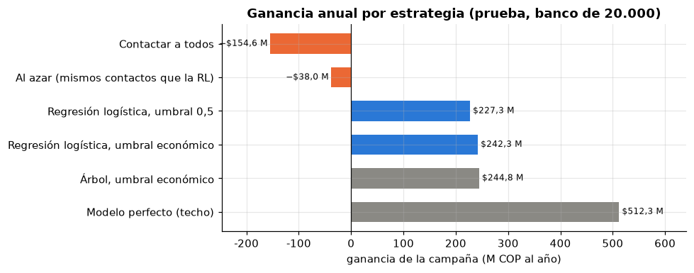

**Informe ejecutivo**  
Predicción de abandono de clientes  

**Para:** Gerencia comercial y de riesgo · Banco cliente de FinAlpes  
**Preparado por:** Mateo Jurado e Iván Herrera · MINE-4101 Ciencia de Datos Aplicada, Universidad de los Andes · noviembre de 2026  
**Alcance:** prueba de concepto con 10.045 clientes europeos, trasladada a un banco colombiano de 20.000 clientes con 15 % de abandono anual.

---

El modelo genera una ganancia anual de **COP 242,3 millones**. Contactar a todos los clientes, en cambio, genera una pérdida de COP 154,6 millones. Con el modelo solo se contacta al 24,5 % de la base (unos 4.900 clientes) y, de esos, el 42 % realmente abandonaría (frente al 15 % de la población general). Después de descontar el costo de operar el modelo, el beneficio neto queda en **COP 199,6 millones**. La inversión inicial de COP 102,5 millones se recupera en **6,2 meses**. En 5.000 escenarios simulados, la campaña gana dinero en el **99 %** de los casos.

### Lo que encontramos

Sin modelo, la campaña destruye valor. Con una tasa de abandono del 15 %, la gran mayoría de las ofertas (85 de cada 100) llegan a clientes que no pensaban irse, y el banco paga por todas igual. Contactar al azar el mismo número de clientes tampoco funciona: sigue generando pérdida (alrededor de COP 38 millones). El valor no está en hacer la campaña, sino en elegir bien a quién se le hace.

El modelo cambia el resultado. Al enfocarse solo en el 24,5 % de clientes con mayor riesgo, cada peso invertido en la campaña devuelve 2,26 pesos. Se retienen aproximadamente 620 clientes al año.

Además, el valor está muy concentrado. El 8 % de clientes con mayor riesgo (unos 1.600, de los cuales el 72 % termina abandonando) concentra el **75 % de la ganancia total**. Si el presupuesto o la capacidad del call center son limitados, conviene empezar por ese grupo.

La regla de decisión es sencilla: contactar a un cliente tiene sentido solo si su probabilidad de abandono supera el **18,7 %**. Esa cifra sale de dividir el costo del contacto (unos COP 39.200) entre lo que se gana al retenerlo (30 % × COP 700.000). Si cambian los costos o el ingreso promedio, el umbral se ajusta automáticamente.

En cuanto al perfil, los clientes más propensos a abandonar tienden a tener un solo producto o, curiosamente, entre 3 y 4 productos (en este último grupo la tasa de abandono supera el 80 %). También destacan los de 45 a 60 años, los inactivos y los de la región con mayor abandono en los datos (Alemania). Los clientes con exactamente dos productos son, por lejos, los más leales.

El resultado es bastante robusto. El modelo genera ganancia en el 99 % de los escenarios simulados y recupera la inversión en menos de dos años en el 88 % de ellos. El supuesto más delicado es la efectividad de la oferta: asumimos que convence al 30 % de los clientes en riesgo. Si esa cifra baja del 13 %, la campaña deja de cubrir el costo de operar el modelo.

Todavía hay margen de mejora. Hoy el modelo captura el 47 % del valor que se obtendría con un modelo perfecto (COP 512 millones). Solo usa variables demográficas y de productos. Incorporar transacciones, uso de canales y quejas (PQRS) debería cerrar buena parte de esa brecha.

### Riesgos y limitaciones

Los datos son europeos. Los patrones por país o género pueden no trasladarse directamente a Colombia, así que el modelo debe reentrenarse con información del banco antes de usarse en producción.

La efectividad del 30 % es un supuesto del caso, no un dato medido internamente. Los costos también vienen de referencias de mercado (tarifas de call center, salarios, SMS), no de cotizaciones propias del banco.

El modelo utiliza género y país. Aunque el objetivo es ofrecer un beneficio, el área de cumplimiento debería revisarlo.

### Recomendación

Implementar el modelo, pero empezando con un piloto controlado.

1. Correr un piloto de tres meses con el 10 % de clientes de mayor riesgo, dejando un grupo de control aleatorio sin contactar para medir la efectividad real de la oferta.
2. Reentrenar el modelo con datos del banco antes de escalar.
3. Diseñar ofertas por segmento: venta cruzada de un segundo producto para quienes tienen uno solo, revisión de cobros y experiencia para quienes tienen 3-4, y reactivación para los inactivos.
4. Escalar al 25 % de la base solo si el piloto confirma una efectividad de al menos ≈ 23 % (el nivel con el que la inversión se recupera dentro del primer año).
5. Enriquecer el modelo con datos de comportamiento y validar con cumplimiento el uso de variables sensibles.

---

*El detalle técnico, los supuestos con sus fuentes y el análisis de sensibilidad completo están en los notebooks [02_modelado_interpretacion.ipynb](../notebooks/02_modelado_interpretacion.ipynb) y [03_generacion_valor.ipynb](../notebooks/03_generacion_valor.ipynb).*